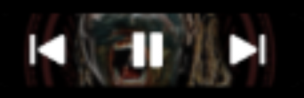
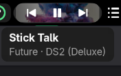

# Now Playing for GNOME

A GNOME Shell extension that shows the current track from any MPRIS media player (Spotify, browsers, VLC, ...) in the top bar, with playback controls.





Requires GNOME Shell 50.

<details><summary>Where it sits in the top bar</summary>


</details>

## Install

```bash
git clone https://github.com/voidrlm/gnome-now-playing.git ~/.local/share/gnome-shell/extensions/now-playing@arjun
```

Log out and back in, then enable it:

```bash
gnome-extensions enable now-playing@arjun
```

## Update

```bash
git -C ~/.local/share/gnome-shell/extensions/now-playing@arjun pull
```

Then log out and back in.
